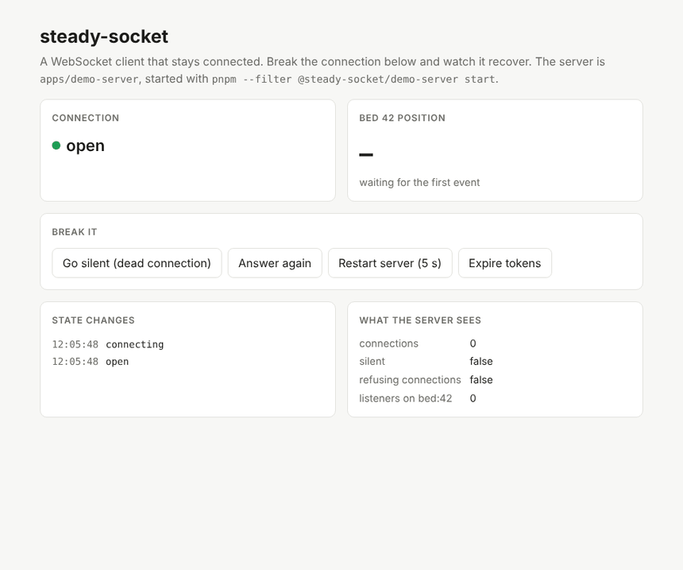

# steady-socket

> A WebSocket client that stays connected — on the web and in React Native.

[](https://www.npmjs.com/package/steady-socket) [](https://github.com/lalmachado/steady-socket/actions/workflows/ci.yml) 

`steady-socket` wraps the platform `WebSocket` with the parts every real-time app ends up rewriting: heartbeats that catch dead connections, reconnects with backoff and jitter, fresh auth on every reconnect, subscriptions that come back by themselves, and awareness of when a mobile app goes to the background.

The core is plain TypeScript with no dependencies. A thin React layer sits on top and runs unchanged in Next.js and Expo.

> **Status:** early release (0.x). The API is complete for what is described below and is covered by tests, but it may still change in minor versions until 1.0. Changes are listed in [CHANGELOG.md](./CHANGELOG.md); the plan is in [ROADMAP.md](./ROADMAP.md).

---

## Why

A WebSocket that works in a demo and one that works in production are different things. Reconnecting clients such as `partysocket` and `reconnecting-websocket` already cover backoff and a fresh URL on each connect, and `react-use-websocket` has a heartbeat. What none of them does is the part that sits on top of the connection:

- **The server forgets your subscriptions.** A new connection starts empty. Whatever the client was listening to has to be sent again, after auth and in the right order. `steady-socket` reference-counts subscriptions per topic and replays them after your `onOpen` auth step on every reconnect.
- **Mobile apps go to sleep.** In the background, timers stop being reliable and the OS may drop the connection. When the app comes back, the user expects live data immediately, not after the next backoff step. `steady-socket` takes React Native's `AppState` (passed in by you) and skips the backoff wait on foreground.
- **Connections die without telling you.** A NAT timeout, a proxy, or a phone switching from Wi-Fi to 4G can leave a socket that looks open but delivers nothing. No `close` event ever fires. Only a heartbeat catches it, and `partysocket` has none.
- **Bad credentials should stop the loop.** A close code that means "your token is wrong" moves the socket to `closed` with a reason instead of retrying forever.

All of it sits behind a small, explicit state machine you can observe and test, with no dependencies in the core.

## Install

```bash
npm install steady-socket
```

React and React Native support are included as subpath exports. `react` is an optional peer dependency, and `steady-socket` never imports `react-native` directly.

## Quick start

```ts
import { createSocket } from 'steady-socket';

type Incoming = { type: 'pong' } | { type: 'event'; topic: string; payload: { position: number } };

type Outgoing =
  | { type: 'ping' }
  | { type: 'auth'; token: string }
  | { type: 'subscribe' | 'unsubscribe'; topic: string };

const socket = createSocket<Incoming, Outgoing>({
  // Called on every connect, so each reconnect gets a fresh token.
  url: async () => `wss://api.example.com/ws?token=${await getToken()}`,

  heartbeat: {
    interval: 15_000, // send a ping every 15 s
    timeout: 5_000, // no pong within 5 s → treat the socket as dead
    ping: () => ({ type: 'ping' }),
    isPong: (msg) => msg.type === 'pong',
  },

  reconnect: {
    minDelay: 500,
    maxDelay: 30_000,
    factor: 2,
    jitter: 'full',
  },

  subscriptions: {
    subscribe: (topic) => ({ type: 'subscribe', topic }),
    unsubscribe: (topic) => ({ type: 'unsubscribe', topic }),
    topicOf: (msg) => (msg.type === 'event' ? msg.topic : undefined),
  },
});

socket.onState((state) => console.log(state));
// 'idle' → 'connecting' → 'open' → 'reconnecting' → 'open' … → 'closed'

const stop = socket.subscribe('bed:42', (msg) => {
  if (msg.type === 'event') console.log(msg.payload);
});

socket.connect();

// later
stop();
socket.close();
```

## Auth on every connection

Protocols differ. Some take the token in the URL, which the async `url` option covers. Others expect an auth message first. `onOpen` runs after the socket opens and **before** anything else is sent, so the server always sees auth first. The socket stays `connecting` until the promise `onOpen` returns resolves; if it rejects, the connection is dropped and retried. Subscriptions are replayed right after it, and messages queued while offline go out after that:

```ts
createSocket({
  url: 'wss://api.example.com/ws',
  onOpen: async (send) => {
    send({ type: 'auth', token: await getToken() });
  },
  // Close codes that mean "your credentials are bad": don't keep retrying with them.
  isAuthFailure: (event) => event.code === 4401,
  // …
});
```

## Subscriptions

With the `subscriptions` option, `socket.subscribe(topic, handler)` listens to one topic and returns a function that stops listening.

- **Reference-counted.** Two listeners on `bed:42` send one `subscribe` message. `unsubscribe` is sent when the last listener leaves. Calling a returned function twice is harmless.
- **Replayed on every connection.** The server forgets everything when a connection drops, so the topics are sent again, in the order they were first subscribed, after `onOpen` finishes. A topic that everyone left while the socket was offline is not replayed.
- **Routed by `topicOf`.** A message reaches the listeners of the topic `topicOf` returns for it. Messages with no topic only reach `onMessage`.
- **Order on each connection:** `onOpen` messages, then replayed subscriptions, then anything queued with `queueWhileOffline`. All of it is sent before the state becomes `open`, so a state listener can't jump ahead of it.
- After `close()`, topics are forgotten and `subscribe()` does nothing.

## React

```tsx
import { SocketProvider, useSocketState, useSubscription } from 'steady-socket/react';

type EventMessage = Extract<Incoming, { type: 'event' }>;

function App() {
  return (
    <SocketProvider socket={socket}>
      <BedStatus id="42" />
    </SocketProvider>
  );
}

function BedStatus({ id }: { id: string }) {
  const state = useSocketState(); // built on useSyncExternalStore
  const [position, setPosition] = useState<number>();

  useSubscription<EventMessage>(`bed:${id}`, (msg) => setPosition(msg.payload.position));

  if (state !== 'open') return <p>Reconnecting…</p>;
  return <p>Position: {position}</p>;
}
```

- **`SocketProvider`** only provides the socket. You create it, call `connect()` and decide when to `close()` it.
- **`useSocketState()`** re-renders only when the connection state changes. During server rendering it returns `'idle'`.
- **`useSubscription(topic, handler)`** subscribes on mount and unsubscribes on unmount. It does not resubscribe when you pass a new handler on every render, and always calls the latest one. It resubscribes only if `topic` or the socket changes. It is safe under React Strict Mode: the mount/unmount/mount cycle leaves exactly one listener.
- **Types:** the provider erases the socket's message types, so `useSocket<Incoming, Outgoing>()` and `useSubscription<Incoming>()` take them as type arguments. Like `fetch<T>()`, that is your claim and is not checked at runtime.
- Needs React 18 or newer (it uses `useSyncExternalStore`).
- **Create the socket in an effect, not at module level.** `close()` is final, and React Strict Mode runs an effect, cleans it up and runs it again in development; a client component also renders on the server, where there is no connection to make. So create, `connect()` and `close()` the socket together inside one `useEffect`, and render the provider once it exists. The [web demo](./apps/web/app/demo.tsx) does exactly that.

## React Native and the browser

The `lifecycle` option connects the socket to its environment. An adapter is attached when you call `connect()` and removed on `close()`.

**React Native.** Pass `AppState` in; the package never imports `react-native`. When the app comes back to `active`, the socket does not wait for its next scheduled attempt: if it is reconnecting, it connects straight away; if it looks open, it pings straight away (needs `heartbeat`), so a connection the OS dropped in the background is replaced in seconds.

```ts
import { AppState } from 'react-native';
import { appStateLifecycle } from 'steady-socket/react-native';

const socket = createSocket({
  // …
  heartbeat: {/* … */},
  lifecycle: appStateLifecycle(AppState),
});
```

**Web.** `browserLifecycle()` listens to the browser:

- `offline` pauses reconnecting. The socket waits in `reconnecting` and does not use up attempts.
- `online` ends the pause and connects straight away (or pings, if the socket is open).
- A tab becoming visible again does the same: skip any backoff wait, or check that an open connection is still alive.

```ts
import { browserLifecycle, createSocket } from 'steady-socket';

const socket = createSocket({ /* … */ lifecycle: browserLifecycle() });
```

Pinging on wake only works if you configured `heartbeat`; without it, an open socket is left alone because there is nothing to ask it.

## Connection states

```
idle ──connect()──▶ connecting ──open──▶ open
                        ▲                  │
                        │            close / heartbeat timeout
                        │                  ▼
                        └──backoff──── reconnecting
                                           │
              close() from any state  ─────┴────▶ closed
```

`close()` is final: it works from any state, cancels pending timers, and the socket never reconnects. `connect()` only does something from `idle`. When a socket ends up `closed`, `socket.closeReason` says why (`'closed-by-user'`, `'connection-lost'` when reconnecting is off, `'max-attempts'`, or `'auth-failure'` when `isAuthFailure` returned true for the close event).

With `heartbeat` set, a pong that does not arrive within `timeout` closes the socket with code 4000 and goes to `reconnecting` straight away, without waiting for a `close` event that a dead connection may never send. Pongs are consumed by the heartbeat and are not passed to `onMessage` listeners.

`socket.state` always holds the current state, and `onState` notifies every transition. A connection that fails auth (`isAuthFailure`) goes to `closed` with a reason, rather than retrying forever.

## Options

| Option                | Default | What it does                                                                                                                                                                                     |
| --------------------- | ------- | ------------------------------------------------------------------------------------------------------------------------------------------------------------------------------------------------ |
| `url`                 | —       | A string, or a sync or async function called on every connect.                                                                                                                                   |
| `protocols`           | —       | Passed through to `WebSocket`.                                                                                                                                                                   |
| `heartbeat`           | off     | `interval`, `timeout`, `ping()`, `isPong(msg)`.                                                                                                                                                  |
| `reconnect`           | on      | `minDelay` (500), `maxDelay` (30 000), `factor` (2), `jitter` (`'full'` or `'none'`, default `'full'`), `maxAttempts` (default: no limit), `random` (for tests). `false` turns reconnecting off. |
| `queueWhileOffline`   | off     | Max number of messages `send()` buffers while the socket is not open. Without it, `send()` throws when not open.                                                                                 |
| `subscriptions`       | off     | `subscribe(topic)`, `unsubscribe(topic)`, `topicOf(msg)`.                                                                                                                                        |
| `onOpen`              | —       | Async hook before subscriptions are replayed.                                                                                                                                                    |
| `isAuthFailure`       | —       | Close events that should stop reconnecting.                                                                                                                                                      |
| `lifecycle`           | —       | `browserLifecycle()` or `appStateLifecycle(AppState)`: pauses and wakes the socket from environment events.                                                                                      |
| `serialize` / `parse` | JSON    | Message encoding.                                                                                                                                                                                |
| `WebSocket`           | global  | The constructor to use. Pass `ws` in Node, or a fake in tests.                                                                                                                                   |

## Testing your app

Because the `WebSocket` constructor can be injected, you can test code that uses `steady-socket` without a server. The package's own tests use a fake socket and fake timers to drive every transition, including heartbeats that never get a pong.

## Demo

`apps/demo-server` is a WebSocket server that can go silent while staying open, restart, and expire
tokens on request. `apps/web` is a Next.js page that uses `steady-socket` against it, so you can
break the connection and watch it recover. See the [web demo](./apps/web/README.md) and the
[server](./apps/demo-server/README.md). A React Native demo is planned and is not built yet.



## Contributing

Issues and PRs are welcome. `pnpm test` runs the suite and `pnpm changeset` records a change for the next release. [RELEASING.md](./RELEASING.md) explains how releases are published.

## License

MIT © Luís Machado
